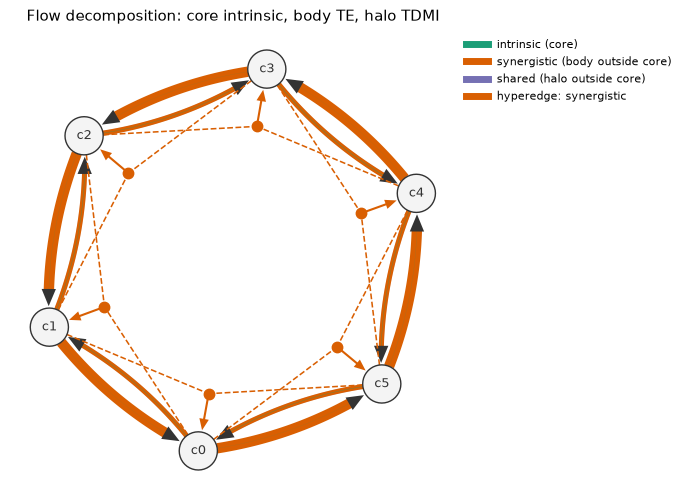
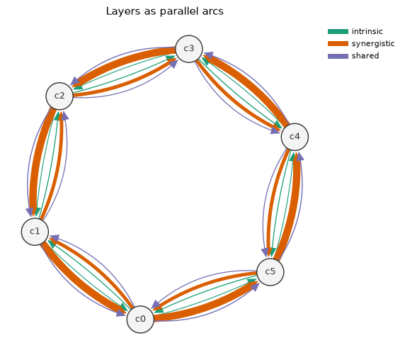
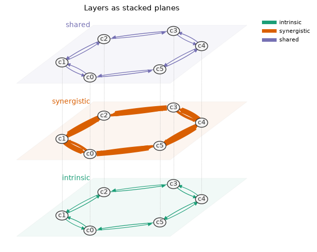
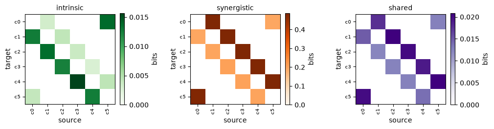

Drawing networks
================

:func:`infoflow.draw.draw` draws a :class:`~infoflow.MultiplexNetwork` in one of four
views, interactively with HoloViews and bokeh or as a static matplotlib figure
(``pip install 'infoflow[plot]'``). Every view first builds a backend-neutral
:class:`~infoflow.draw.Scene`, so the interactive plot and the exported figure show the
same thing. Node positions are shared by every view and layer: a spring layout of the
union of all layers' significant edges by default, ``layout="circle"``, or your own
``positions``.

.. code-block:: python

   from infoflow.draw import draw, save

   fig = draw(net, "glyphs", hyperedges=True, machines=True)   # bokeh, with hover
   save(fig, "network.html")
   fig = draw(net, "stacked", backend="matplotlib")            # static
   save(fig, "network.pdf")

The figures below are a noisy rule-110 cellular automaton on six cells
(:func:`~infoflow.datasets.noisy_eca`), whose flow is almost all synergistic.

Decomposition glyphs
--------------------

``view="glyphs"`` draws one arrow per source–target pair that encodes the
decomposition's identities. The core's width is the intrinsic flow; the body's is the
transfer entropy (intrinsic + synergistic); the halo's is the time-delayed mutual
information (intrinsic + shared). So the part of the body outside the core is
synergy, and the part of the halo outside the core is shared flow. A dashed grey
arrow inside a halo is a pair with significant shared flow but no significant
transfer.

``hyperedges=True`` overlays the significant PID hyperedges
(:func:`~infoflow.hyperedges.multivariate_hyperedges`): a hub, coloured by its label
(synergistic, redundant, unique-dominated, mixed), joins each source set to its
target. ``machines=True`` sizes nodes by their ε-machines' statistical complexity and
adds the machine layer (:doc:`machines`) to the hover: ε-machine and transducer
states, ``h_mu``, the transducer transfer entropy and its gap.

Parallel arcs and stacked planes
--------------------------------

``view="arcs"`` draws one arc per layer and pair, coloured by layer, with width ∝
weight; ``view="stacked"`` draws each layer on its own tilted plane, with every
node's copies joined across planes.

Layer matrices
--------------

``view="matrices"`` draws a source × target heatmap per layer (non-significant values
blank), which scales to large networks. ``common_scale=True`` puts every layer on one
colour range, since the layers share units.

