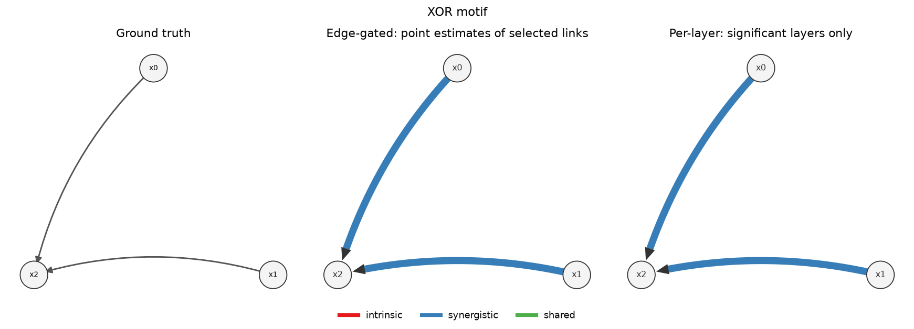
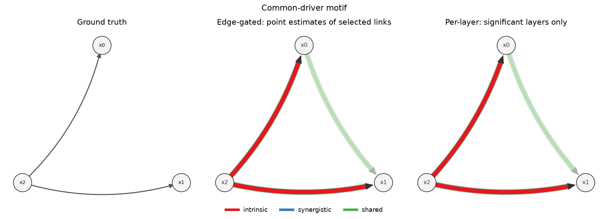
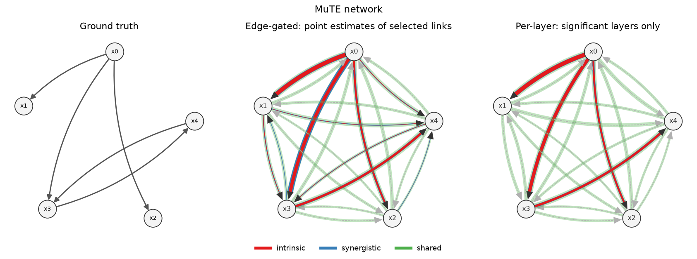
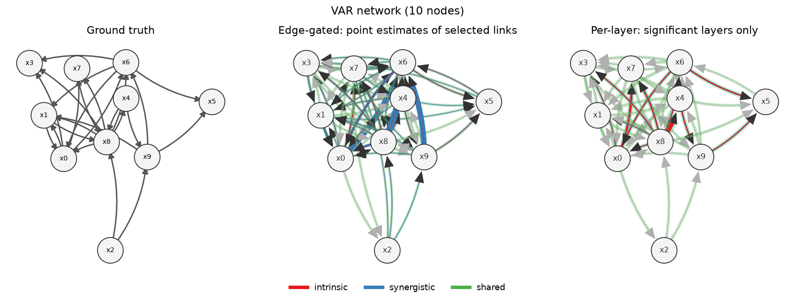
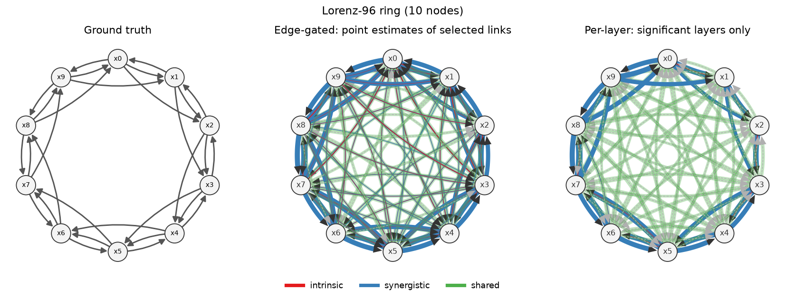
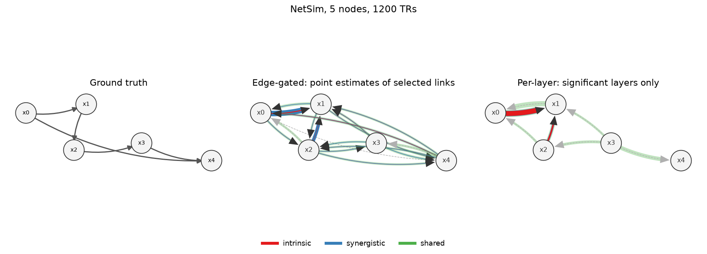
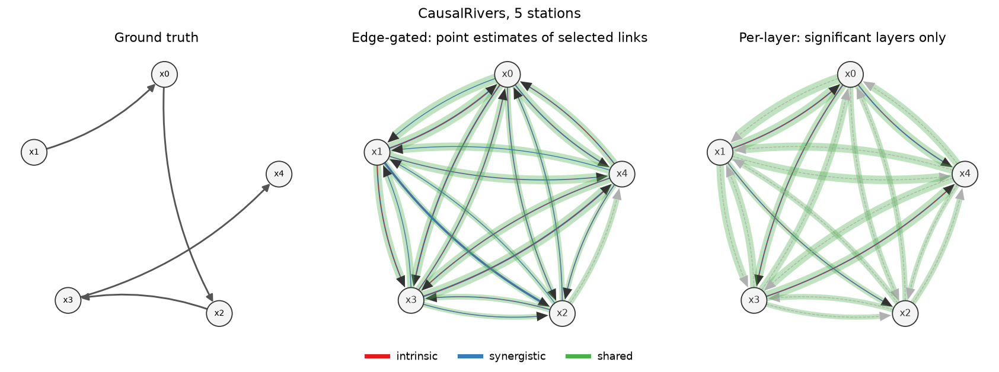

# infoflow on network-inference benchmarks

*Branch `literature-review`, October 2026. Scripts: `validation/external.py`,
`validation/layer_report.py`, `validation/layer_analysis.py`; numbers below are from
those scripts and `docs/benchmarks.rst`.*

## Summary

- **Finding links.** On synthetic systems, `infoflow.infer` (the automatic mode)
  ranks links as well as or better than a VAR (linear Granger) and PCMCI+ baseline,
  and is clearly ahead on nonlinear dynamics. On real or realistic data it is level
  with the fair linear baseline but not ahead of the best published numbers.
  Precision is high everywhere it was measured on synthetic data; recall is
  conservative.
- **Layers.** The intrinsic/synergistic/shared breakdown differs sharply between
  systems and matches their construction where that is known: pure synergy for XOR,
  intrinsic flow for chains and common drivers, synergy-dominated flow for the
  multiplicative Lorenz-96 coupling, and shared-dominated flow for river discharge
  driven by common weather.
- **Two ways of reporting layers.** Gating on the edge's transfer entropy and then
  reading off the point estimates gives every selected edge a composition, but its
  dominant layer is unsupported by that layer's own test on 14-100% of the links in
  four of the six benchmark systems (all of NetSim's). Testing each layer directly is
  reliable but, in the same four systems, leaves 8-25% of selected links with no
  confirmed transfer layer. We recommend
  reporting point estimates with intervals for every selected edge and claiming a
  layer only where its own test is significant.

## 1. Finding links

Mean AUROC of the link scores (higher is better; 0.5 is chance).
Synthetic: 10- and 20-node networks, 1000 samples, five simulations each.

| Benchmark | infoflow | VAR | PCMCI+ | Notes |
|---|---|---|---|---|
| VAR networks | **0.97-0.99** | 0.95-0.98 | 0.93-0.97 | infoflow precision 0.99-1.00; recall 0.57-0.79 against PCMCI+ 0.78-0.90 |
| Coupled logistic maps | **0.92-0.97** | 0.72-0.76 | 0.73-0.76 | nonlinear coupling |
| Lorenz-96 | **1.00** | **1.00** | 0.74-0.80 | VAR precision 0.87, infoflow 1.00 |
| NetSim fMRI, direction | 0.61-0.77 | 0.53-0.80 | 0.46-0.70 | 10 subjects per simulation |
| NetSim fMRI, either direction | 0.65-0.81 | 0.54-0.93 | 0.52-0.73 | VAR best with long sessions |
| CausalRivers, 3 stations | 0.70 | 0.69 (scale-free) / 0.75 (raw) | — | 40 subgraphs, 6-hour data |

On CausalRivers, the VAR that scores links by raw-unit coefficients (0.75 here; 0.80-0.82
in the benchmark paper with label-tuned settings) uses the fact that big rivers lie
downstream; ordering stations by mean discharge alone scores about as well. infoflow is
rank-based and ignores magnitudes, so the scale-free VAR is the like-for-like
comparison. CausalTime and CauseMe could not be run (data unreachable; platform-only
scoring).

## 2. Layer breakdown

Each selected link's flow is split into **intrinsic** (what the source tells about the
target that no use of the context can remove), **synergistic** (what it tells only
jointly with the context), and **shared** (what it tells redundantly with the
context, e.g. through a common driver). Shares are means over correctly selected
links of each layer's fraction of their total flow (intrinsic + synergistic +
shared). The last two columns count the shared-only links (time-delayed dependence
without transfer) reported per network and the fraction of them that are true links.

| Benchmark | Networks | Precision | Recall | Intrinsic | Synergistic | Shared | Shared-only links / network | of which true |
|---|---|---|---|---|---|---|---|---|
| Chain *a → b → c* | 5 | 1.00 | 1.00 | 1.00 | 0.00 | 0.00 | 1.2 | 0.00 |
| Common driver | 5 | 1.00 | 1.00 | 1.00 | 0.00 | 0.00 | 1.0 | 0.00 |
| XOR | 5 | 1.00 | 1.00 | 0.00 | 1.00 | 0.00 | 0.0 | — |
| Orthogonal features | 5 | 1.00 | 1.00 | 0.71 | 0.29 | 0.00 | 0.0 | — |
| MuTE network | 5 | 1.00 | 0.80 | 0.53 | 0.16 | 0.31 | 16.0 | 0.06 |
| VAR networks (10 nodes) | 3 | 1.00 | 0.64 | 0.32 | 0.32 | 0.35 | 43.7 | 0.18 |
| Coupled logistic maps | 3 | 1.00 | 0.25 | 0.15 | 0.85 | 0.00 | 0.0 | — |
| Lorenz-96 (10 nodes) | 3 | 1.00 | 0.92 | 0.07 | 0.74 | 0.19 | 61.7 | 0.04 |
| NetSim, 5 nodes, 1200 TRs | 5 | 0.67 | 0.16 | 0.09 | 0.71 | 0.20 | 12.0 | 0.33 |
| NetSim, 10 nodes, 200 TRs | 5 | — | 0.00 | — | — | — | 0.0 | — |
| CausalRivers, 3 stations | 10 | 0.57 | 0.60 | 0.04 | 0.04 | 0.92 | 3.8 | 0.18 |
| CausalRivers, 5 stations | 10 | 0.47 | 0.53 | 0.04 | 0.05 | 0.90 | 15.5 | 0.12 |

(`auto` fast preset with shared-only candidates on, five motifs or three synthetic
networks per row; weak versions of the motifs, with noisier couplings and 800-1000
samples, gave the same breakdowns. The motif rows' common-driver shared-only link is the
confounded pair, which carries shared flow only, as designed.)

What the breakdowns say:

- **Motifs** come out as constructed. The orthogonal-features targets add an AR term
  to a binary input; binning that sum makes source and target past jointly
  informative, so about 30% of the flow is synergistic in symbol space.
- **Lorenz-96** is synergy-dominated, as its multiplicative coupling
  (xi+1 − xi−2) xi−1 implies: each neighbour informs
  xi mostly jointly with the others.
- **River discharge** is about 90% shared: stations are driven by the same weather
  and seasons, and most of what an upstream station's past says about a downstream
  one is said by the downstream station's own past too.
- **Shared-only links are not causal links**: 67-96% of them join stations or nodes
  that are not linked, as expected for dependence produced by common drivers. They are
  useful as a map of shared dynamics, not as edges of the causal graph.
- **NetSim** gives few links (fMRI directionality is hard, and the 200-sample sessions
  yield none at infoflow's strict level), so its breakdown rests on few links.

## 3. Edge-level gating versus per-layer testing

**Edge-gated.** A link is reported when its transfer entropy passes parent selection
(or, for a shared-only link, its time-delayed mutual information passes the screen),
and its intrinsic, synergistic, and shared flows are reported as point estimates. A
natural reading labels the link by its dominant layer.

**Per-layer.** Each layer has its own permutation null (a parametric projection with
zero intrinsic flow, context permutations within the minimizing channel's clusters for
synergy, unconditional context permutations for shared flow), with false-discovery-rate
control across links within each layer. A layer is claimed only where its test is
significant. This is infoflow's current behaviour.

Both were evaluated on the same estimates for every correctly selected link.

| Benchmark | Dominant layer confirmed by its test | No transfer layer significant | Synergy-dominant by point estimate | Synergy significant | Shared-only links: gated → tested |
|---|---|---|---|---|---|
| Motifs (all eight) | 1.00 | 0.00 | as designed | as designed | 0.6 → 0.55 |
| MuTE | 1.00 | 0.00 | 0.10 | 0.25 | 16.0 → 15.2 |
| VAR networks | 0.57 | 0.14 | 0.39 | 0.00 | 43.7 → 26.0 |
| Coupled logistic maps | 1.00 | 0.00 | 1.00 | 1.00 | 0 → 0 |
| Lorenz-96 | 0.86 | 0.12 | 1.00 | 0.86 | 61.7 → 59.7 |
| NetSim, 5 nodes | 0.00 | 0.25 | 1.00 | 0.00 | 12.0 → 5.8 |
| CausalRivers, 3 stations | 0.83 | 0.08 | 0.25 | 0.17 | 3.8 → 3.8 |
| CausalRivers, 5 stations | 0.67 | 0.24 | 0.33 | 0.10 | 15.5 → 15.5 |

Findings:

1. **On the motifs the two approaches agree**, with one exception that is a matter of
   definition: on orthogonal features the per-layer test also confirms the ~30%
   synergistic component that the dominant-layer reading ignores.
2. **Point estimates over-read synergy on linear dynamics.** In the VAR networks 39% of
   links have more synergistic than intrinsic flow by point estimate, yet no synergy
   survives its test on any link; the synergistic estimate is the transfer entropy
   minus a downward-biased intrinsic estimate, so it absorbs estimation error. On
   NetSim no dominant label is confirmed at all. Where synergy is real (XOR,
   logistic maps, Lorenz-96) its test confirms it on 86-100% of links.
3. **Per-layer testing costs coverage.** On the VAR networks, Lorenz-96, NetSim, and
   CausalRivers, 8-25% of selected links have no significant intrinsic or synergistic
   layer (none on MuTE and the logistic maps), although their
   transfer entropy is significant: power is split across layers and the intrinsic
   flow, an infimum over channels, is hard to separate from zero in small samples.
4. **The shared-only screen is permissive at the edge level.** Per-layer testing
   removes about 40-50% of the shared-only links on the VAR networks and NetSim, but few
   elsewhere; most remaining shared-only links are still not true links (see Section 2).

**Recommendation.** Report, for every link selected by its transfer entropy, the three
layers' point estimates with their bootstrap intervals, and make layer-specific
claims ("this link is synergistic") only where that layer's own test is significant.
The edge-level gate controls errors for the existence of a link, not for its
composition.

## 4. Example networks

One network per benchmark, the instance with median recall rather than the best.
Each figure shows the ground truth (left), what edge-level gating reports (centre:
every layer of each link whose transfer entropy passed selection, and the intrinsic
and shared layers of shared-only links), and what per-layer testing confirms (right).
Each arrow is a glyph of the decomposition: its red core is intrinsic flow, the blue
body around the core is synergistic flow, and the green halo is shared flow; widths
are proportional to bits, and links with shared flow only appear as faint green
arrows. Node positions are shared across the three panels. (`validation/layer_figures.py`.)

**XOR.** Both inputs reach x2 as pure synergy, with no intrinsic core, and both
approaches agree.

**Common driver.** x2's links to its two children are intrinsic; the confounded pair
x0 → x1 appears only as a shared-flow link, as designed.

**MuTE.** Four of the five links are found, all with confirmed intrinsic flow (x4 → x3
is missed). Edge gating adds a synergistic body to x0 → x3 that its test does not
confirm. The many faint green links are shared flow among the driver's descendants.

**VAR network.** 17 of 24 links found, none false. By point estimate 8 of them are
synergy-dominated (the blue bodies in the centre); per-layer testing confirms synergy
on none and intrinsic flow on 12, as expected for linear additive coupling.

**Lorenz-96.** All 30 ring links are found. All are synergy-dominated by point
estimate and 24 have synergy confirmed by its test, matching the multiplicative
coupling; the small intrinsic cores of the centre panel survive their tests on only 8. The dense web of shared-only links reflects ring-wide correlation; few of
them are true links.

**NetSim.** Two links are selected: x0 → x1, which is true, and x2 → x1, the reverse of
the true x1 → x2. The centre panel's other arrows are shared-only links. Its synergy
on x0 → x1 is not confirmed; the per-layer panel keeps the intrinsic cores.

**CausalRivers.** Two of four links are found (x1 → x0, x3 → x4). The three false links
are downstream shortcuts (x0 → x3 bypasses x2, x0 → x4 bypasses x2 and x3, x1 → x2
bypasses x0), consistent with smooth discharge whose memory coarse symbols cannot
condition away. Nearly all flow is shared, as in Section 2.

## Caveats

- Small samples: 3-5 networks per synthetic setting, 5 subjects per NetSim simulation,
  10-40 river subgraphs; two baselines only (no VARLiNGAM, DYNOTEARS, or neural
  methods).
- The layer breakdown is computed on the preprocessing symbols, so it depends on the
  discretization (the orthogonal-features synergy is an example).
- Only the motifs have known layer composition; for the other benchmarks the breakdown
  is descriptive.
- Cost: layer estimation dominates the runtime (from seconds for the motifs to about
  27 minutes per 10-node Lorenz-96 network with shared-only candidates).
