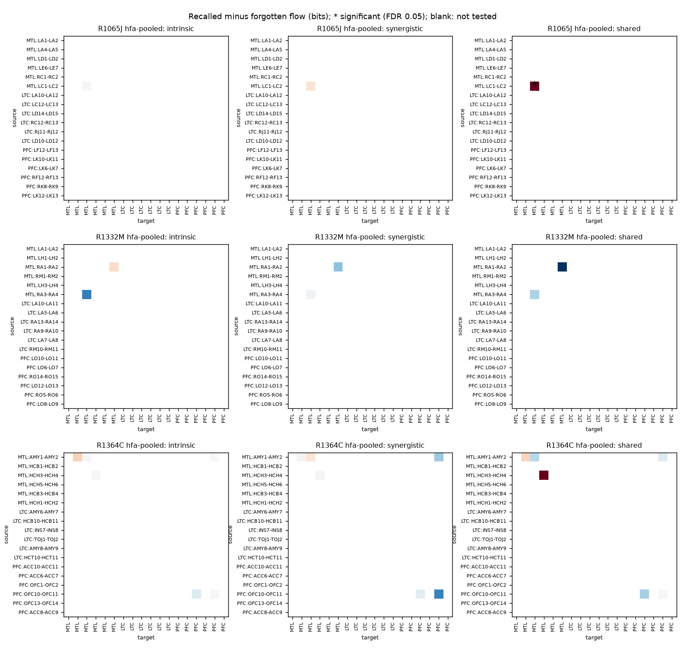
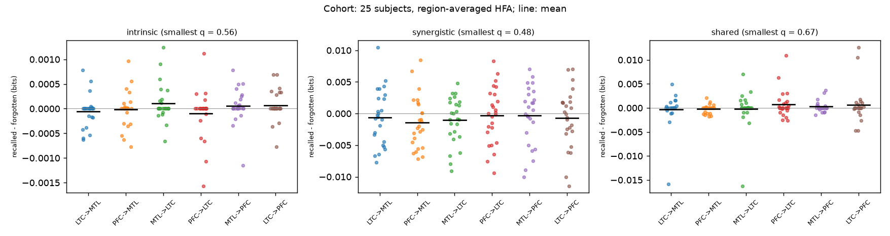

# infoflow on catFR1: a subsequent-memory pilot and cohort

*Branch `catfr-pilot`, October 2026. Scripts: `examples/catfr/{fetch,prepare,run,cohort,null_check,report}.py`;
library changes on `catfr-library-fixes`. Tables are printed by `report.py` from the
per-run summaries.*

## Summary

- **The dataset's event onsets are misaligned; the first pilot runs used them.** The
  BIDS `onset` column of ds004809 is offset from the recording by 1 s to 15 min per
  session (drifting slowly within a session); the `sample` column is aligned. Word-locked
  evoked responses appear only with `sample / sfreq` (evoked power after onset 7.5x and
  4.3x the pre-stimulus level in two subjects, against 0.8x with `onset`). Every
  memory-effect result from the first runs is superseded by the corrected runs below;
  their calibration and engineering findings do not depend on alignment and stand.
- **No subsequent-memory effect in directed flow.** On correctly aligned epochs, the
  three-subject channel-level pilot found one significant edge in six contrasts (HFA,
  shared flow between two MTL contacts in R1065J, q = 0.036) and the 25-subject cohort,
  with one node per region (MTL, lateral temporal, prefrontal), found no region pair and
  layer whose recalled-minus-forgotten flow differs across subjects (18 tests, smallest
  q = 0.48). The same cohort data show the classical amplitude effect (prefrontal HFA
  higher for recalled words in 18 of 25 subjects, p = 0.001), so the data and labels are
  sound and the null is specific to flow.
- **Comparisons need pooled selection.** Testing the union of edges selected in each
  condition gave significant differences between random halves of one condition in
  13-15% of splits instead of 5%. Selecting the tested edges on both conditions pooled
  makes the permutation test exact: intrinsic and shared flow come back to nominal. In a
  100-split check, synergistic flow's per-edge p-values are mildly low between 0.01 and
  0.05 (9.4% below 0.05, uniform below 0.01); modest evidence, from overlapping splits.
- **Library changes** (separate PR): preprocessing no longer crashes on short trials and
  keeps each node's lag budget under the network resolution; `compare_networks` gains
  sequential p-values (7.7x faster on the pilot's HFA contrast, same decisions), a map
  over edges, and pooled-selection guidance; `auto.infer` enforces its time budget with
  deadlines instead of trusting a three-target pilot.

## 1. Data and pipeline

**Dataset.** OpenNeuro [ds004809](https://openneuro.org/datasets/ds004809) (Herrema &
Kahana; catFR1, CC0): BIDS iEEG with bipolar montages, atlas-labelled contacts and
behavioural events, about 250 subjects.

- *Event timing.* Epochs are cut at `sample / sfreq`. The `onset` column differs from it
  by a session-specific offset (R1364C 1.2 s, R1332M 1.5 s, R1065J 56.6 s, R1108J 228 s,
  R1004D 852 s; one session, R1293P, has onsets 23 h into a 68 min recording) that drifts
  by tens of milliseconds over a session, as if `onset` came from the behavioural clock.
  `common.word_events` documents this.
- *Recall labels.* The events carry no `recalled` column; a `WORD` is recalled when a
  `REC_WORD` in the same list names the same item. Practice lists are dropped.
- *No channel exclusion.* The release has no bad-channel or seizure-onset flags.

**Channels.** A bipolar pair keeps a region only if both contacts agree (hippocampal
subfield atlases first, then whole-brain and Desikan-Killiany labels); pairs sharing a
contact are never both used, since they share a signal term (an early smoke test's only
significant edges joined such pairs).

**Signals.** 60 Hz notch and harmonics; WORD epochs 0-1.6 s after onset:

- *broadband*: 1-80 Hz at 200 Hz (320 samples per epoch);
- *HFA*: log mean Morlet power (7 cycles, 8 log-spaced frequencies in 70-150 Hz),
  computed on epochs padded by 1 s and cropped, averaged down to 50 Hz (80 samples).

**Pilot** (`run.py`): three subjects (R1065J, R1364C, R1332M), six pairs per region
(18 nodes), 75-130 trials per condition after balancing by subsampling the larger class.
Preprocessing runs once on all of a session's trials so every condition and split shares
one symbol encoding; one network is selected on both conditions pooled
(`infer_multiplex`, plug-in selection at `auto`'s 0.001 level); `compare_networks`
(within subjects, 500 permutations, `curtail=10`, FDR 0.05 per layer) tests each layer's
recalled-minus-forgotten difference on its edges. Calibration null: random halves of the
larger class (recalled for all three), the size of the main contrast's arms.

**Cohort** (`cohort.py`): one session for each of 25 subjects with at least two
non-overlapping pairs in each region, ranked by trials per condition after balancing
(the 25 chosen have 95-149). Each region's HFA, each pair z-scored first,
is averaged into one node. Every subject is discretized with the same 4 equal-frequency
bins, and `compare_networks(design="between", dependent=True, n_perm=5000)` tests the
paired recalled-minus-forgotten difference across subjects on all six directed region
pairs, with variables fixed in advance (source at lag 2 = 40 ms, target at lags 1-2,
third region at lag 2), so nothing is selected on the data. Each subject also gets the
pilot's within-subject analysis on its three nodes. EDFs are downloaded, epoched and
deleted one at a time (17.6 GB in total).

## 2. Results

### Pilot (channel level, correctly aligned)

| Subject | Signal | Trials / condition | Pooled edges (I/S/Sh) | Significant SME (I/S/Sh) | Null splits with any significant (I/S/Sh) |
|---|---|---|---|---|---|
| R1065J | hfa | 75 | 1/0/1 | 0/0/1 | 0/0/0 of 20 |
| R1332M | hfa | 130 | 2/0/2 | 0/0/0 | 1/2/0 of 20 |
| R1364C | hfa | 79 | 5/0/6 | 0/0/0 | 0/1/1 of 20 |
| R1065J | broadband | 75 | 0/1/3 | 0/0/0 | 0/0/0 of 3 |
| R1332M | broadband | 130 | 3/7/18 | 0/0/0 | 0/0/0 of 3 |
| R1364C | broadband | 79 | 1/4/18 | 0/0/0 | 0/0/1 of 3 |

The one significant edge is shared flow from MTL:LC1-LC2 to MTL:LD1-LD2 in R1065J (two
shafts): 0.023 bits for recalled words against 0.012 for forgotten, q = 0.036. Nothing
comparable appears in the other subjects or in broadband. HFA networks are small (1-6
edges per layer from 18 nodes) and carry intrinsic and shared flow; broadband networks
are mostly shared and synergistic flow (up to 18 shared edges), the signature of common
input or residual volume conduction rather than directed transmission.



**Label check.** Mean HFA 0.4-1.6 s after onset, recalled vs forgotten (Welch t averaged
over each region's pairs): MTL +1.6, +1.2, +2.5 (R1065J, R1332M, R1364C), with 7, 3 and 7
of 18 pairs at p < 0.05, in line with the HFA subsequent-memory literature. With the
misaligned epochs the same check gave 0-2 pairs.

### Cohort (region level, 25 subjects)

| Edge | Intrinsic: rec / forg (bits), q | Synergistic: rec / forg, q | Shared: rec / forg, q |
|---|---|---|---|
| LTC -> MTL | 0.0001 / 0.0002, 0.56 | 0.0069 / 0.0075, 0.72 | 0.0036 / 0.0040, 0.86 |
| PFC -> MTL | 0.0002 / 0.0002, 0.82 | 0.0060 / 0.0074, 0.48 | 0.0007 / 0.0009, 0.67 |
| MTL -> LTC | 0.0002 / 0.0001, 0.56 | 0.0061 / 0.0072, 0.48 | 0.0035 / 0.0037, 0.86 |
| PFC -> LTC | 0.0001 / 0.0002, 0.56 | 0.0067 / 0.0070, 0.77 | 0.0034 / 0.0027, 0.67 |
| MTL -> PFC | 0.0002 / 0.0001, 0.56 | 0.0056 / 0.0059, 0.77 | 0.0010 / 0.0007, 0.67 |
| LTC -> PFC | 0.0002 / 0.0001, 0.56 | 0.0061 / 0.0068, 0.72 | 0.0033 / 0.0028, 0.67 |

Means over subjects; q is FDR-adjusted per layer over the six edges. In every cell
between 4 and 13 of the 25 subjects have recalled above forgotten, so there is no
consistent direction either. Within subjects, pooled selection on the three nodes found
0-4 edges per layer (none in 13 subjects) and one significant difference in 25 subjects (R1201P,
shared MTL to LTC, q = 0.048), about what chance gives.



Over the same 25 subjects and nodes, the classical amplitude effect (mean HFA 0.4-1.6 s,
recalled minus forgotten) is present in PFC (18/25 positive, t = 3.60, p = 0.001), leans
the same way in MTL (16/25, p = 0.16), and is absent in LTC (13/25, p = 0.66).

## 3. Calibration of the comparison

Random halves of one condition have no true difference, however much flow of any kind
the data contain, so every significant result in these splits is a false positive. With
the edges selected label-independently, the permutation test is exact per edge.

| Variant | Null splits | Any significant: intrinsic | synergistic | shared |
|---|---|---|---|---|
| Per-condition selection (misaligned HFA) | 60 | 8 (13%, p = 0.010) | 9 (15%, p = 0.003) | 6 (10%, p = 0.079) |
| Pooled selection (misaligned HFA) | 60 | 4 (7%, p = 0.35) | 8 (13%, p = 0.010) | 4 (7%, p = 0.35) |
| Pooled selection, R1332M, 100 splits | 100 | 6 (6%, p = 0.38) | 10 (10%, p = 0.028) | 3 (3%, p = 0.88) |
| Pooled selection, `curtail=10` (aligned HFA) | 60 | 1 (2%) | 3 (5%) | 1 (2%) |
| Pooled selection, `curtail=10` (aligned broadband) | 9 | 0 | 0 | 1 |

(p: one-sided binomial test against 5%.)

- **Per-condition selection inflates** because an edge strong by chance in one half is
  selected for that reason, and permuting the labels destroys the chance alignment.
  `compare_networks`'s docstring and `docs/workflow.rst` now say so and show the pooled
  pattern.
- **The synergistic excess** (`null_check.py`, R1332M, 100 splits, 170 edge tests,
  per-edge raw p-values recorded): 9.4% of synergistic p-values fall below 0.05 but 1.8%
  below 0.01, and a Kolmogorov-Smirnov test does not reject uniformity (p = 0.43); with
  about 1.7 edges per split, the per-split rate is the per-edge rate, so the FDR step is
  not the cause. The excess is mild, confined to p between 0.01 and 0.05, and the splits
  overlap heavily (all from the same 170 trials), so the binomial p overstates the
  evidence. Intrinsic (6.5% below 0.05) and shared (4.7%) are nominal. Splits 0-19
  reproduce the earlier run exactly.

## 4. Library changes

All on `catfr-library-fixes`, rebased on `main` (after the spike-train merge); the full
test suite passes (281 passed, 2 skipped, plus the new `auto` tests).

1. **Short-trial crash** (`preprocess/scoring.py`). A candidate whose context leaves no
   fold with enough held-out windows returned its per-resolution scores in a different
   shape, and one spanning the whole trial failed on an empty array; both now score 0 and
   are never chosen. `auto.infer` now runs on 80-sample epochs; two regression tests.
2. **Lag budgets under the network resolution** (`preprocess/pipeline.py`). Adoption kept
   only the uniform history (often one sample) as every node's lag budget; nodes now keep
   their own budgets (at least that history). On this data candidate lags became 1-5
   samples for HFA and up to 10 for broadband, instead of 1.
3. **`compare_networks`** (`compare.py`). `curtail` gives sequential Monte Carlo p-values
   (Besag & Clifford 1991): a layer's permutations stop once its permuted difference has
   reached the observed one `curtail` times. On R1364C's HFA contrast (18 tested
   edge-layers), `curtail=10` with 4 threads took 9 s against 69 s for all 500
   permutations serially, with identical decisions. `map_fn` runs edges in parallel with
   seeds drawn up front, and a NaN observed difference now gives a NaN p-value instead of
   the smallest attainable one. Pooled-selection guidance as above.
4. **`auto.infer` time budget** (`auto.py`). Two causes of the broadband overrun: the
   check of nonlinear targets ran a Gaussian selection with a local permutation null per
   target before the pilot, outside the budget; and the pilot's three targets could not
   represent selection times that ranged from 47 s to nearly an hour per target on the
   same data, and predicted zero Gaussian cost when none of them used the Gaussian
   estimator. Now checks not started within half the budget are skipped, targets not
   started within 80% of it select with the plug-in only (both recorded as downgrades),
   and the pilot takes the Gaussian time from the check when it has none. A target
   started just before a deadline still runs to completion, so a run can exceed its
   budget by up to one target's selection. BUDGET_VERIFICATION

## 5. Runtime

16-core laptop shared with other jobs (load 15-25); 4 worker threads per run.

| Run | Preprocess | Contrast (selection + comparison) | Null splits | auto.infer (2 h budget) |
|---|---|---|---|---|
| R1065J HFA | 7 min | 3 min | 44 min (20) | 45 min (predicted 15) |
| R1332M HFA | 7 min | 4 min | 31 min (20) | 49 min (predicted 37) |
| R1364C HFA | 7 min | 6 min | 60 min (20) | 43 min (predicted 15) |
| R1065J broadband | 16 min | 8 min | 23 min (3) | |
| R1332M broadband | 16 min | 91 min | 91 min (3) | |
| R1364C broadband | 17 min | 88 min | 3.9 h (3) | |
| Cohort, 25 subjects | | | | about 2 h end to end, including downloads |

With `curtail`, the comparison is no longer the bottleneck; broadband contrast time is
now mostly the pooled selection on 160-260 trials.

## 6. Caveats

- One session per subject, montages that differ between subjects, and no seizure-onset
  or bad-channel exclusion.
- The cohort's fixed variable set (one source lag, 40 ms) is one pre-specified choice;
  other lags were not tested, to avoid selecting on the data.
- Region averaging trades spatial specificity for power and comparability; it dilutes
  the MTL amplitude effect that the channel-level check shows.
- Bipolar referencing and the shared-contact rule reduce but do not remove volume
  conduction; broadband shared flow is likely partly that.
- A 1.6 s encoding window is short for directed estimates, and pooling it across trials
  assumes stationarity the nonstationary flags dispute.

## 7. Next steps

1. Report the onset misalignment to the dataset maintainers.
2. Look at synergistic flow's p-values between 0.01 and 0.05 directly: the synergy
   estimate is a difference of two estimates, one from a numerical optimisation, and its
   permutation distribution may be lumpy.
3. If directed flow is still of interest: longer windows (encoding plus the following
   item), more subjects, or a pre-specified hypothesis (e.g. MTL to PFC at several lags)
   rather than all pairs.

## Reproducing

```bash
cd examples/catfr
uv run --project ../.. python fetch.py --top 3                        # needs the aws CLI
uv run --project ../.. --with mne --with netcdf4 --with "decorator<5.3" python prepare.py
export OMP_NUM_THREADS=1
uv run --project ../.. --with netcdf4 python run.py --signal hfa --n-null 20
uv run --project ../.. --with netcdf4 python run.py --signal broadband --n-null 3 --skip-auto
uv run --project ../.. --with netcdf4 python null_check.py --subject R1332M --start 0 --count 100
CATFR_OUT=~/data/catfr_cohort uv run --project ../.. --with mne --with netcdf4 --with "decorator<5.3" \
    python cohort.py --subjects 25
uv run --project ../.. --with netcdf4 --with matplotlib python report.py --cohort ~/data/catfr_cohort/cohort/summary.json
```

`CATFR_ROOT` and `CATFR_OUT` override the data and output directories. `decorator`
5.3.1 is broken on PyPI (it installs without its module), hence the pin for `mne`.
